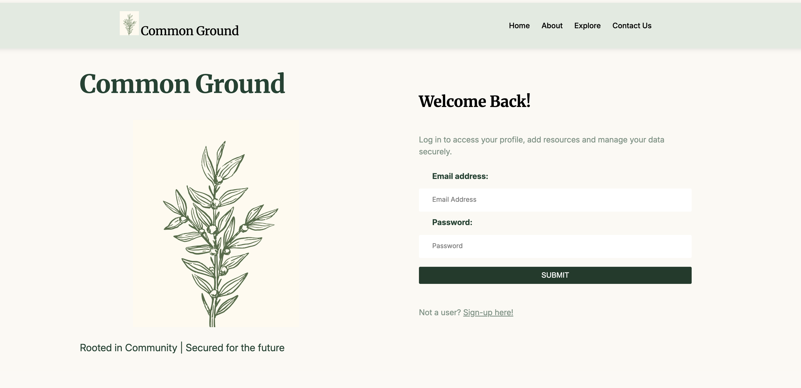

# Common Ground

### Intro:
This full stack app in-the-works is built with urban growers and land stewards of Philadelphia in mind. Philadelphia has a long history of community-managed land, a practice of stewarding vacant and underutilized land in the city.

For decades, information streams between urban farmers, gardeners, and advocates have been strained. Older populations and non-English-speaking populations often get left behind. 

Common Ground is breaking this cycle, by providing a community-trusted communication system, land protection monitor, and rescource map that address the biggest obstacle for urban farmers: land security. 

## Features
- This app will include authentication and login for secure accesss to the communication system and to share resources. Creating a login is not necessary for viewing the resource maps.
    - Part of the signup process will require a referral from other users to ensure that bad actors are not able to access land tracking information.
- This app will use GIS components for more accessible viewing and geolocating user experience.
- Resource Map exists as a compilation of shared resources from users.
- Tax Foreclosure map uses a Philadelphia tax foreclosure API to monitor if there are any flagges parcels of land that are of interest to users.
    - The information will be generalized, limited to the number of affected vacant lots in their respective district. This is a security check to prevent land speculators from potentially accessing information about land that is already used and managed by community members.
- This app will offer a ciitzen science forum so that advice, growing techniques, and wisdom from diverse communities can be collected and offered back to the user community.

### Live Link

To access this website-in-progress you can [**click here**](https://common-ground-q46x.onrender.com/).

### How to Use:
- Create a login with a community 'check' so that the full app can only be accessed by users with invite codes from current users. 
- View the Resource Map to see what districts other users are located and available resources.
- View the tax foreclosure service to check if land that you're stewarding is at risk and add it to your land tracker in your profile. 
- Use a form to submit resources. Add as many as you like!
- Read about advice, ag experiments and wisdom that others share in the citizen science forum. 
- Delete anything you create.  

### Tech Stack: 
- Front-end: HTML, CSS, JavaScript 
- Backend: Node.js, Express, EJS, passport
- Database: MongoDB

### How to run project: 
- **This is a work in progress**
- Stay tuned for more working features!